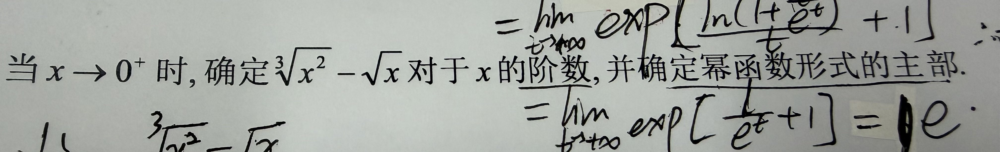

当 $x \to 0^+$ 时，确定 $\sqrt[3]{x^2}-\sqrt{x}$ 对于 $x$ 的阶数，并确定幂函数形式的主部。

解：
将根式写为分数指数形式：

$$  
\sqrt[3]{x^2}=x^{\frac{2}{3}},\quad \sqrt{x}=x^{\frac12}
$$  

$$  
\sqrt[3]{x^2}-\sqrt{x}=x^{\frac{2}{3}} - x^{\frac12}
$$  

比较指数：$\dfrac12 < \dfrac{2}{3}$  ，$x\to 0^+$ 时 $x^{\frac12}$   是主导项。

$$
\lim_{x\to 0^+}\frac{x^{\frac{2}{3}} - x^{\frac12}}{x^{\frac12}}
=\lim_{x\to 0^+}\left(x^{\frac{1}{6}}-1\right)= -1
$$  

因此：
- $\sqrt[3]{x^2}-\sqrt{x}$ 是 $x$ 的 $\boldsymbol{\dfrac12}$ 阶无穷小；
- 幂函数形式的主部为 $\boldsymbol{-x^{\frac12}}$。
