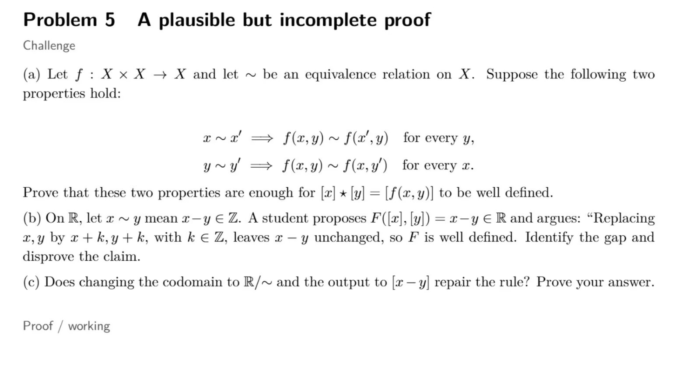

### [mail me](zoexiong@fantastic-studio.top)

***

## (a) Proof that  $[x]\star [y] = [f(x,y)]$  is well-defined

Let  $\sim$  be an equivalence relation on the set  $X$ . The quotient set is defined as

$$
X/{\sim} = \{[z] \mid z\in X\},
$$

where  $[z] = \{w\in X \mid w\sim z\}$  denotes the equivalence class of  $z$ .

A rule of the form  $[x]\star [y] = [f(x,y)]$  is **well-defined** if and only if for all  $x,x',y,y'\in X$ ,

$$
[x]=[x'] \text{ and } [y]=[y'] \implies [f(x,y)] = [f(x',y')].
$$

By the definition of equivalence classes,  $[x]=[x'] \iff x\sim x'$ , and  $[y]=[y'] \iff y\sim y'$ .
We assume

$$
x\sim x',\qquad y\sim y'.
$$

We are given two conditions for the map  $f\colon X\times X\to X$ :
1. For all  $x,x',y\in X$ :  $x\sim x' \implies f(x,y)\sim f(x',y)$ .
2. For all  $x,y,y'\in X$ :  $y\sim y' \implies f(x,y)\sim f(x,y')$ .

From  $x\sim x'$  and condition (1), fixing the second argument  $y$ :

$$
f(x,y) \sim f(x',y).
$$

From  $y\sim y'$  and condition (2), fixing the first argument to  $x'$ :

$$
f(x',y) \sim f(x',y').
$$

Equivalence relations are transitive: for any  $a,b,c\in X$ , if  $a\sim b$  and  $b\sim c$ , then  $a\sim c$ .
Set  $a=f(x,y)$ ,  $b=f(x',y)$ ,  $c=f(x',y')$ . Transitivity gives

$$
f(x,y) \sim f(x',y').
$$

Elements that are equivalent lie in the same equivalence class:

$$
[f(x,y)] = [f(x',y')].
$$

Therefore the result of  $\star$  depends only on the input equivalence classes  $[x],[y]$ , not the chosen representatives  $x,y$ . The operation is well-defined. $\square$

---

## (b) Identify the logical gap and disprove  $F([x],[y]) = x-y \in \mathbb R$

Define the relation  $\sim$  on  $\mathbb R$  by

$$
\forall a,b\in\mathbb R,\quad a\sim b \iff a-b\in \mathbb Z.
$$

This is an equivalence relation on  $\mathbb R$ .

The student proposes a mapping

$$
F\colon \mathbb R/{\sim}\times \mathbb R/{\sim} \to \mathbb R,\qquad F([x],[y]) = x-y,
$$

and argues that substituting  $x\mapsto x+k$ ,  $y\mapsto y+k$  for  $k\in\mathbb Z$  leaves  $x-y$  unchanged.

### The Gap
For a function defined on pairs of equivalence classes to be well-defined, whenever  $[x]=[x']$  and  $[y]=[y']$ , we must permit **independent changes of representatives**:
-  $[x]=[x']$  means there exists  $k\in\mathbb Z$  such that  $x' = x + k$ .
-  $[y]=[y']$  means there exists  $m\in\mathbb Z$  such that  $y' = y + m$ .

The integers  $k,m$  are not required to coincide. The student only tested the special case  $k=m$ , which is insufficient to verify well-definedness over all valid substitutions of representatives.

### Disproof by counterexample
Take  $x=0$ ,  $y=0$ . Then  $[x]=[0]$ ,  $[y]=[0]$ .
Choose alternative representatives for these same classes:

$$
x' = 1,\quad y' = 0.
$$

Check equivalence:
-  $x'-x = 1-0 = 1\in\mathbb Z \implies x'\sim x$ , so  $[x']=[x]=[0]$ .
-  $y'-y = 0-0 = 0\in\mathbb Z \implies y'\sim y$ , so  $[y']=[y]=[0]$ .

Evaluate the proposed rule on the two representative choices:

$$
F([0],[0]) \text{ via }(x,y)=(0,0):\quad 0-0 = 0,
$$

$$
F([0],[0]) \text{ via }(x',y')=(1,0):\quad 1-0 = 1.
$$

Since  $0\neq 1$  in  $\mathbb R$ , the rule assigns two distinct real values to the identical pair  $([0],[0])$ .
Hence  $F([x],[y])=x-y$  is **not well-defined**. $\square$

---

## (c) Is  $G([x],[y]) = [x-y] \colon \mathbb R/{\sim}\times\mathbb R/{\sim} \to \mathbb R/{\sim}$  well-defined?

**Claim:** This rule is well-defined.

**Proof:**
Assume  $[x]=[x']$  and  $[y]=[y']$  in  $\mathbb R/{\sim}$ .
By definition of  $\sim$ :

$$
x' \sim x \implies \exists\,k\in\mathbb Z,\ x' = x + k,
$$

$$
y' \sim y \implies \exists\,m\in\mathbb Z,\ y' = y + m.
$$

Compute the difference for the new representatives:

$$
x' - y' = (x+k)-(y+m) = (x-y)+(k-m).
$$

Since  $k,m\in\mathbb Z$ , we have  $k-m\in\mathbb Z$ . Rearranging:

$$
(x'-y') - (x-y) = k-m \in \mathbb Z.
$$

Applying the definition of  $\sim$  on  $\mathbb R$ :

$$
x'-y' \;\sim\; x-y.
$$

Equivalent elements share the same equivalence class:

$$
[x'-y'] = [x-y].
$$

This equality demonstrates that the output equivalence class depends only on the input equivalence classes  $[x],[y]$ , and not the particular representatives  $x,y$  chosen.
Therefore  $G([x],[y])=[x-y]$  is a well-defined function on the product of the quotient sets. $\square$

### Remark
The modification succeeds because the codomain is now the quotient  $\mathbb R/{\sim}$ . Integer offsets introduced by switching representatives are absorbed by the equivalence relation, so integer discrepancies no longer produce distinguishable outputs in the quotient, unlike the previous codomain  $\mathbb R$ .

