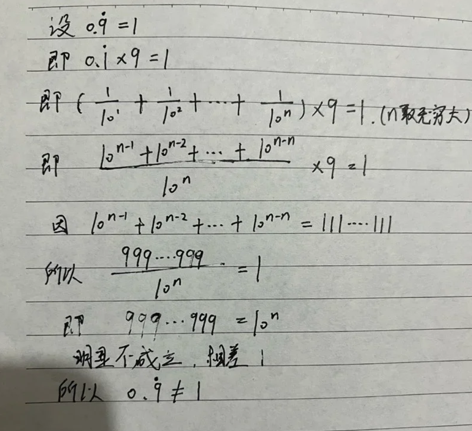

# 对  $0.\overline{9}\neq 1$  」错误论证的严谨驳斥
### [小红书博主@小祥不想上班 id：63538104987](https://xhslink.cn/o/7h9r0pPDaav)

## [1. 复述原论证](https://www.rednote.com/discovery/item/697de6240000000021028d45?app_platform=harmony&app_version=9.52.2&share_from_user_hidden=true&xsec_source=app_share&type=normal&xsec_token=CBxx19JdZUJtBJSW-_2L2AZju6wtGn1tp658vnB4Lmfkc=&author_share=1&share_id=c96bd8fd3a2d42858c1757f4a64e1bb9&track_code=7h9r0pPDaav)

手写推导的逻辑链条整理如下：
1. 将循环小数  $0.\overline{9}$  等同于有限截断形式

$$  
\frac{\overbrace{999\cdots 9}^{n\text{ 位}}}{10^n}
$$  

并标注条件“  $n$   趋于无穷大”；  
2. 对等式 $\displaystyle\frac{\overbrace{999\cdots 9}^{n\text{ 位}}}{10^n}=1$ 做移项，得到

$$
\overbrace{999\cdots 9}^{n\text{ 位}} = 10^n;
$$
  
3. 由于对任意有限正整数 $n$，恒有

$$
\overbrace{999\cdots 9}^{n\text{ 位}} = 10^n - 1 \neq 10^n,
$$

据此得出结论：  $0.\overline{9}\neq 1$  。  

## 2. 实分析标准定义
按照无限小数的规范定义：

$$
0.\overline{9} := \lim_{n\to\infty} a_n,\quad a_n = \frac{10^n - 1}{10^n}=1-\frac{1}{10^n}.
$$

这里有一条核心区分：

$$
\boldsymbol{0.\overline{9} \neq a_n},\quad \forall \text{ 固定有限的 } n\in\mathbb N.
$$

$0.\overline{9}$ 是数列 $\{a_n\}$ 的**极限**，并不是把某个下标 $n$ 取成“无穷”之后代入得到的某一项。
记号 $\displaystyle\lim_{n\to\infty}$ 是作用在数列上的算子；$\boldsymbol{\infty}$ 不属于自然数集 $\mathbb N$，不能像普通实数一样直接代入代数式做四则运算。

## 3. 形式化驳斥
原论证依赖一条无效的逻辑蕴含式：

$$
\Big(\forall n\in\mathbb N,\ a_n < 1\Big) \implies \lim_{n\to\infty} a_n \neq 1.
$$

在数列极限的 $\varepsilon$–$N$ 定义之下，该命题不成立。

### 回顾数列极限定义
$\displaystyle\lim_{n\to\infty}a_n = L$ 的含义为：

$$
\forall \varepsilon>0,\ \exists N\in\mathbb N,\ \forall n\in\mathbb N,\ n>N \implies |a_n - L|<\varepsilon.
$$

极限定义**不要求存在某个下标 $n$，使得 $a_n = L$**，它只要求：当下标充分大时，数列各项与 $L$ 的距离可以小于任意预先给定的正数 $\varepsilon$。

### 严格证明 $\displaystyle\lim_{n\to\infty}\left(1-\frac{1}{10^n}\right)=1$
任取 $\varepsilon>0$。
取 $N = \lceil -\log_{10}\varepsilon\rceil$。对所有满足 $n>N$ 的正整数：

$$
\left|\left(1-\frac{1}{10^n}\right)-1\right|
=\left|-\frac{1}{10^n}\right|
=\frac{1}{10^n}
<\frac{1}{10^N}\le \varepsilon.
$$

依据数列极限定义可得：

$$
\lim_{n\to\infty}\left(1-\frac{1}{10^n}\right)=1.
$$

结合循环小数定义，于是

$$
0.\overline{9}=1.
$$

## 4. 定位原稿的代数错误
作者错误地把极限等式

$$
\lim_{n\to\infty}\frac{10^n-1}{10^n}=1
$$

理解为：

$$
\exists n,\quad \frac{10^n-1}{10^n}=1
\;\implies\;
10^n-1=10^n.
$$

这属于范畴混淆：
- 命题 $\displaystyle\lim_{n\to\infty} f(n)=C$，**并不代表方程 $f(n)=C$ 在自然数集中有解**；
- 我们不能随意丢掉极限符号，对极限内部的表达式直接套用有限等式的移项规则。

举一个对照的经典例子：令 $b_n = \dfrac1n$，有

$$
\lim_{n\to\infty}\frac1n = 0,
$$

但是对每一个 $n\in\mathbb N$，都有 $\dfrac1n>0$。
如果照搬原稿的推理模式，就会推出荒谬结论：
> 既然对所有 $n$ 都有 $\dfrac1n>0$，那么 $\displaystyle\lim_{n\to\infty}\frac1n\neq 0$。
这个反例直接暴露了原推理规则本身是失效的。

## 5. 结语
每一段有限截断小数 $0.\underbrace{999\cdots9}_{n}<1$，这件事实和恒等式 $0.\overline{9}=1$ 完全相容。
所谓矛盾，根源是混淆了**收敛数列的单独项**与**数列的极限值**，这是在理解实数无限小数表示时非常典型的误区。
