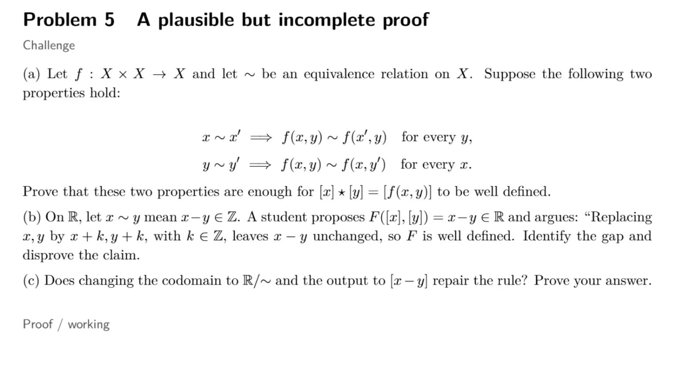

### [mail me](zoexiong@fantastic-studio.top)

***

# Well-Definedness of Binary Operations on Quotient Sets

> Abstract: Equivalence relations and quotient sets are foundational objects in set theory and abstract algebra. When defining functions whose inputs are equivalence classes, one must verify well-definedness: the output must not depend on the choice of representative for each class. This note first proves a general sufficient condition for a binary operation $[x] \star [y] = [f(x,y)]$ on a quotient set to be well-defined. It then studies two candidate mappings on $\mathbb{R}/{\sim}$, where $a \sim b \iff a-b \in \mathbb{Z}$. We expose the logical flaw in an incomplete student argument and give an explicit counterexample showing that $F([x],[y]) = x-y$ fails to be well-defined into $\mathbb{R}$. Finally, we prove that $G([x],[y]) = [x-y]$ becomes well-defined when the codomain is taken to be the quotient $\mathbb{R}/{\sim}$.

**Keywords**: equivalence relation; quotient set; equivalence class; well-defined function; real numbers modulo integers

---

## 1. Introduction

Let $X$ be a set equipped with an equivalence relation $\sim$. The quotient set is defined by

$$
X/{\sim} = \{ [z] \mid z \in X \},
$$

where the equivalence class of $z$ is

$$
[z] = \{ w \in X \mid w \sim z \}.
$$

A rule of the form

$$
\star \colon X/{\sim} \times X/{\sim} \to X/{\sim},\qquad [x] \star [y] = [f(x,y)]
$$

is **well-defined** if for all $x,x',y,y' \in X$,

$$
[x] = [x'],\quad [y] = [y'] \implies [f(x,y)] = [f(x',y')].
$$

In plain language: the value of the operation must depend only on the equivalence classes of the inputs, not on the particular representatives chosen. This is a necessary condition before such a rule can be regarded as a genuine function.

In §2 we establish a general criterion for well-definedness of such binary operations. In §3 we consider the equivalence relation on $\mathbb{R}$ where two real numbers are equivalent if and only if they differ by an integer. We examine a proposed mapping into $\mathbb{R}$, identify the gap in a flawed argument, and disprove well-definedness by counterexample. In §4 we prove that the analogous construction with codomain $\mathbb{R}/{\sim}$ yields a well-defined subtraction operation, and we explain why the change of codomain resolves the difficulty. Section 5 concludes.

## 2. A general sufficient condition for well-definedness

Let $f \colon X \times X \to X$ satisfy the following two compatibility conditions with respect to $\sim$:

1. For all $x,x',y \in X$: if $x \sim x'$, then $f(x,y) \sim f(x',y)$.
2. For all $x,y,y' \in X$: if $y \sim y'$, then $f(x,y) \sim f(x,y')$.

**Theorem 2.1.** Under these hypotheses, the operation

$$
[x] \star [y] = [f(x,y)]
$$

is well-defined on $X/{\sim}$.

> *Proof.*
> Assume $[x] = [x']$ and $[y] = [y']$. By definition of equivalence classes, this is equivalent to $x \sim x'$ and $y \sim y'$.
>
> By condition (1), fixing the second argument:
>
> $$
> f(x,y) \sim f(x',y).
> $$
>
> By condition (2), applied with first argument $x'$:
>
> $$
> f(x',y) \sim f(x',y').
> $$
>
> Since $\sim$ is an equivalence relation, it is transitive. Therefore
>
> $$
> f(x,y) \sim f(x',y').
> $$
>
> Equivalent elements belong to the same equivalence class, so
>
> $$
> [f(x,y)] = [f(x',y')].
> $$
>
> Hence the output class is independent of the choice of representatives, and $\star$ is well-defined.
> $\square$

This theorem encapsulates the standard verification strategy for quotient operations: one checks separate compatibility in each variable, then combines the two statements using transitivity of the equivalence relation.

## 3. A non-well-defined function on $\mathbb{R}/{\sim}$

Define the relation $\sim$ on $\mathbb{R}$ by

$$
\forall a,b \in \mathbb{R},\quad a \sim b \iff a-b \in \mathbb{Z}.
$$

It is routine to verify that $\sim$ is reflexive, symmetric, and transitive, so it is indeed an equivalence relation. The class $[x]$ is often written $x+\mathbb{Z}$.

Now consider the proposed mapping

$$
F \colon \mathbb{R}/{\sim} \times \mathbb{R}/{\sim} \to \mathbb{R},\qquad F([x],[y]) = x-y.
$$

A student claims: if we replace $x \mapsto x+k$ and $y \mapsto y+k$ for $k\in\mathbb{Z}$, then $x-y$ is unchanged, so $F$ is well-defined. We isolate the flaw and disprove the claim.

### 3.1. The logical gap

For well-definedness, representatives may be changed independently:
- $[x] = [x']$ means there exists $k\in\mathbb{Z}$ such that $x' = x + k$;
- $[y] = [y']$ means there exists $m\in\mathbb{Z}$ such that $y' = y + m$.

The integers $k$ and $m$ are **not required to be equal**. The student’s argument only covers the special case $k=m$, which is insufficient to guarantee invariance under all admissible substitutions.

### 3.2. Counterexample

Take $x = 0$, $y = 0$, so $[x] = [0]$ and $[y] = [0]$. Choose new representatives for the same classes:

$$
x' = 1,\qquad y' = 0.
$$

We check:

$$
x' - x = 1 \in \mathbb{Z} \implies x' \sim x,\qquad y' - y = 0 \in \mathbb{Z} \implies y' \sim y.
$$

Thus $[x'] = [x]$ and $[y'] = [y]$. Now evaluate the proposed rule:

$$
F([0],[0]) = 0 - 0 = 0,\qquad F([0],[0]) = 1 - 0 = 1.
$$

Since $0 \neq 1$ in $\mathbb{R}$, the rule assigns two distinct real numbers to the same pair $([0],[0])$. Therefore $F$ is **not well-defined**.

The root difficulty is that the codomain $\mathbb{R}$ can detect integer differences that the input equivalence relation ignores. Shifting $x$ by an integer while holding $y$ fixed changes the value of $x-y$ as a real number.

## 4. Well-definedness of subtraction within the quotient

We now consider the modified rule

$$
G \colon \mathbb{R}/{\sim} \times \mathbb{R}/{\sim} \to \mathbb{R}/{\sim},\qquad G([x],[y]) = [x-y].
$$

**Theorem 4.1.** The function $G$ is well-defined.

> *Proof.*
> Assume $[x] = [x']$ and $[y] = [y']$. Then there exist integers $k,m\in\mathbb{Z}$ such that
>
> $$
> x' = x + k,\qquad y' = y + m.
> $$
>
> Compute:
>
> $$
> x' - y' = (x+k) - (y+m) = (x-y) + (k-m).
> $$
>
> Since $k,m\in\mathbb{Z}$, their difference $k-m$ is also an integer. Rearranging:
>
> $$
> (x'-y') - (x-y) = k-m \in \mathbb{Z}.
> $$
>
> By definition of $\sim$, this gives
>
> $$
> x'-y' \sim x-y.
> $$
>
> Equivalent elements share the same equivalence class, so
>
> $$
> [x'-y'] = [x-y].
> $$
>
> The resulting class depends only on $[x]$ and $[y]$, not on the representatives chosen. Hence $G$ is well-defined.
> $\square$

The change of codomain is decisive. Although $x-y$ and $x'-y'$ may differ as real numbers, their integer discrepancy is absorbed by the equivalence relation defining $\mathbb{R}/{\sim}$. This quotient is the familiar additive group of real numbers modulo one.

## 5. Conclusion

Well-definedness is an indispensable, subtle requirement for functions defined on quotient sets. In general, a binary operation $[x]\star [y] = [f(x,y)]$ is guaranteed well-defined if $f$ is separately compatible with the equivalence relation in each argument. On $\mathbb{R}$ modulo integer differences, defining the output to be a real number fails because independent representative shifts can alter the numerical value of $x-y$. When the output is instead taken to be an equivalence class in $\mathbb{R}/{\sim}$, integer shifts are quotiented away, and subtraction becomes a well-defined binary operation.

The contrast between $F$ and $G$ illustrates a recurring theme in quotient constructions: the codomain must be chosen so that all ambiguities introduced by different representative choices are identified by the equivalence relation.

